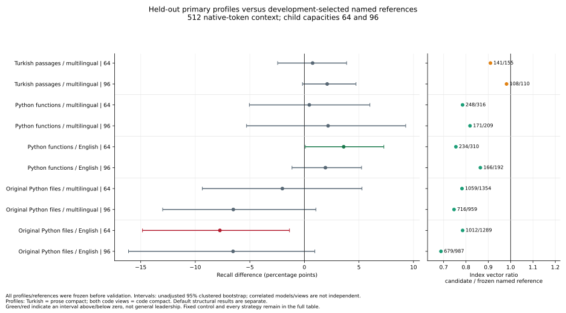
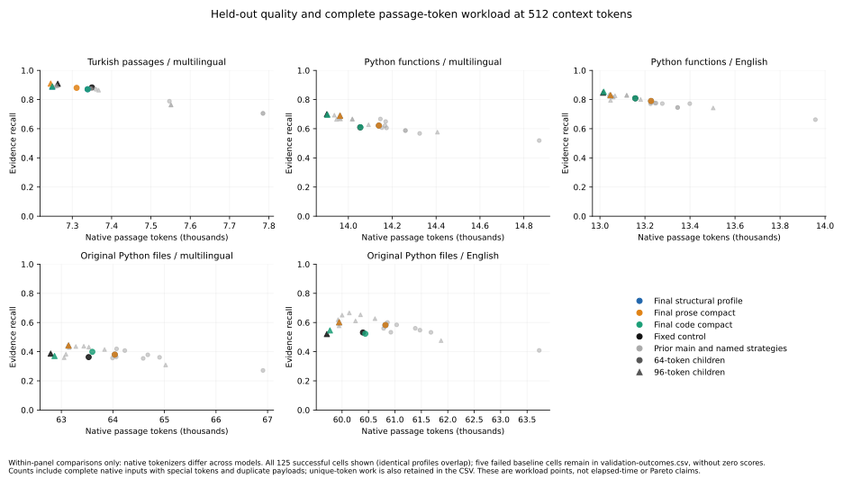

# Retrieval quality and cost on real-source corpora, v3

**OmniChunk shows a narrow, descriptive code-retrieval advantage in one English encoder/64-token cell against the strongest observed conforming named strategy, while tying the fixed splitter there. Broad superiority and a Pareto advantage are not established.** Multilingual isolated code does not establish an advantage over its strongest controls, and compact code regresses substantially at 96 tokens on real files. The retained structural default has separate gains against prior OmniChunk in some settings. Those secondary gains do not replace the frozen primary-profile results.

## Frozen experiment and interpretation

Prior-main baseline: `e63c7f097a8ccec39262c8fb00fb2375a3e5283d`. Evaluated runtime and harness:
[`d0bd4b5ea10ff458313a82b3340c8f1a3f49e572`](https://github.com/oguzhankir/omnichunk/tree/d0bd4b5ea10ff458313a82b3340c8f1a3f49e572).
The source/model/settings freeze is [freeze-before-validation-v3.json](evidence/top-level/freeze-before-validation-v3.json.gz), SHA256 `54f2d64ede52854e41f9dffaa4235f0eb991f3bc8df1031916754dbac188a334`.
The two earlier freeze records were superseded before validation release to finish correctness/review repairs; their hashes and reasons remain preserved. No profile or model setting was selected from released validation scores. The post-validation performance repair below is separate from this frozen runtime.

A subsequent PR review found repeated whole-suffix tokenization in compact code. The production repair grows prefix probes, verifies the selected prefix, and retains full-range recovery when no bounded prefix fits. A further review also repaired list ownership after code fences nested inside Markdown list items. These corrections were made **after validation release**, without quality tuning. The numeric tables below remain results for frozen `d0bd4b5`; compact token boundaries can change with the repair. The [post-validation input comparison](post-validation-input-audit.json) records its effects separately: 92 of 108 profile/model/capacity inputs are identical; 16 compact-code inputs change. All source, budget and protection checks pass. The default and prose profiles remain identical. No new held-out quality claim follows from this repair.

The [reference choices](evidence/top-level/reference-choices-before-validation.json.gz) and its [commitment](evidence/top-level/reference-selection-commitment.json.gz) fixed the primary candidate and named comparator from development before release: Turkish uses prose-compact; both code views use code-compact. The selected named strategy maximized development primary recall, then precision and fewer vectors, with a stable name tie-breaker. Fixed is always a separate control. All three candidate profiles and every admitted baseline remain visible. An observed-best validation mean is reported separately as an **ex-post descriptive control**, not a replacement for the preselected comparator.

| Protocol item | Frozen value |
| --- | --- |
| Native chunk capacities | 64 and 96, special tokens included |
| Primary complete retrieved context | 512 native tokens, two-newline separators included, whole ranked prefix |
| Sensitivity contexts | 128 and 256, predeclared; shared frozen vectors/rankings, no new inference |
| Ranking metric | Separate top-k 5, not interchangeable with byte evidence recall |
| Primary overlap/context | Zero overlap and no derived context |
| Models | Multilingual MiniLM-L12-v2 `e8f8c211226b894fcb81acc59f3b34ba3efd5f42`; English MiniLM-L6-v2 `1110a243fdf4706b3f48f1d95db1a4f5529b4d41` |
| Encoder/input contract | Real local pretrained Transformer + mean pooling (+ Normalize for English), no prompts; full native inputs, overflow rejected rather than truncated |
| Runtime | CPU, batch 32, two Torch threads and two interop threads; three chunking repetitions |
| Uncertainty | 2,000 paired cluster-bootstrap draws, seed 0, percentile 95% intervals; 16 repository clusters for each code view, 60 source-passage clusters for Turkish |

Intervals are **unadjusted under many capacities, profiles, references, budgets and slices**. They are descriptive, not family-wise controlled significance tests. The two encoders and two code views are correlated measurements; they are not independent replications or extra datasets. Native tokenizers differ, so cross-model score differences are not a controlled model ranking. Query-mean byte precision/recall/IoU do not measure generated-answer correctness, minimal support sufficiency or production adoption.

## Primary 512-token validation results

ML = multilingual encoder, EN = English encoder. W/T/L counts paired query recall wins/ties/losses, with tolerance 1e-12. Each code row has 64 queries on isolated functions or 56 correlated queries on files; Turkish has 120. References below are exactly the pre-release development choices. Missing/nonconforming cells have no invented zero score.

| View / encoder / capacity | Frozen candidate | Recall | Preselected named reference | Reference recall | Δ recall [unadjusted 95% interval] | W/T/L |
| --- | --- | --- | --- | --- | --- | --- |
| turkish / ML / 64 | prose-compact | 0.880231 | semantic-code | 0.872693 | +0.007539 [-0.024508, +0.038681] | 24/73/23 |
| turkish / ML / 96 | prose-compact | 0.909365 | semantic-code | 0.888484 | +0.020881 [-0.001758, +0.047290] | 22/86/12 |
| code / ML / 64 | code-compact | 0.609956 | chonkie-sentence | 0.605438 | +0.004518 [-0.050434, +0.060002] | 26/15/23 |
| code / ML / 96 | code-compact | 0.696169 | chonkie-sentence | 0.674466 | +0.021703 [-0.053018, +0.092840] | 25/29/10 |
| code / EN / 64 | code-compact | 0.808351 | llamaindex-sentence | 0.772361 | +0.035990 [+0.000811, +0.072792] | 47/1/16 |
| code / EN / 96 | code-compact | 0.853381 | semantic-text-splitter | 0.834118 | +0.019262 [-0.011361, +0.052401] | 11/42/11 |
| code-files / ML / 64 | code-compact | 0.399108 | semantic-text-splitter | 0.419300 | -0.020193 [-0.093536, +0.052773] | 18/19/19 |
| code-files / ML / 96 | code-compact | 0.370523 | semchunk | 0.435657 | -0.065134 [-0.129877, +0.010541] | 15/20/21 |
| code-files / EN / 64 | code-compact | 0.523090 | semantic-text-splitter | 0.600524 | -0.077434 [-0.148360, -0.013667] | 18/14/24 |
| code-files / EN / 96 | code-compact | 0.545764 | langchain | 0.611148 | -0.065384 [-0.161174, +0.009540] | 17/12/27 |

The fixed control and the observed highest-mean named control are distinct checks. “Observed best” below excludes fixed and prior OmniChunk and is chosen **after seeing validation only to expose the strongest observed control**; it does not retroactively change the frozen comparison. Native `semantic-code` is semantic-text-splitter's CodeSplitter for Python and its documented text fallback for prose, not a new independent library.

| View / encoder / capacity | Fixed recall | Candidate − fixed [95% interval] | Observed best named: recall | Candidate − observed best [95% interval] | Vectors: candidate / fixed / observed best |
| --- | --- | --- | --- | --- | --- |
| turkish / ML / 64 | 0.883262 | -0.003031 [-0.024677, +0.016989] | semchunk: 0.873912 | +0.006319 [-0.023016, +0.034689] | 141 / 141 / 159 |
| turkish / ML / 96 | 0.908215 | +0.001150 [-0.003404, +0.006499] | chonkie-sentence: 0.893654 | +0.015711 [-0.008961, +0.042488] | 108 / 108 / 116 |
| code / ML / 64 | 0.609360 | +0.000596 [+0.000000, +0.001787] | semantic-text-splitter: 0.666716 | -0.056760 [-0.116271, -0.004990] | 248 / 248 / 302 |
| code / ML / 96 | 0.699509 | -0.003340 [-0.010021, +0.000000] | semantic-text-splitter: 0.692799 | +0.003370 [-0.038785, +0.046062] | 171 / 171 / 197 |
| code / EN / 64 | 0.808351 | +0.000000 [+0.000000, +0.000000] | semchunk: 0.775593 | +0.032759 [+0.004717, +0.061695] | 234 / 234 / 296 |
| code / EN / 96 | 0.847181 | +0.006199 [-0.000946, +0.020017] | semantic-text-splitter: 0.834118 | +0.019262 [-0.011361, +0.052401] | 166 / 166 / 192 |
| code-files / ML / 64 | 0.362808 | +0.036299 [-0.012918, +0.077311] | semantic-text-splitter: 0.419300 | -0.020193 [-0.093536, +0.052773] | 1059 / 1008 / 1354 |
| code-files / ML / 96 | 0.386688 | -0.016165 [-0.100934, +0.071890] | langchain: 0.437738 | -0.067214 [-0.153066, +0.031346] | 716 / 671 / 1036 |
| code-files / EN / 64 | 0.531499 | -0.008409 [-0.089977, +0.071969] | semantic-text-splitter: 0.600524 | -0.077434 [-0.148360, -0.013667] | 1012 / 961 / 1289 |
| code-files / EN / 96 | 0.520881 | +0.024884 [-0.059141, +0.108411] | semchunk: 0.666038 | -0.120273 [-0.217150, -0.036199] | 679 / 639 / 928 |

The narrow favorable cell is isolated code / EN / 64: compact recall 0.808351 versus observed-best named semchunk 0.775593; paired delta +0.032759 [+0.004717, +0.061695], W/T/L 38/13/13. Its 234 vectors versus 296 are 20.95% fewer, while precision/IoU and token work remain separately reported. **Fixed recall is 0.808351 with paired delta +0.000000 [+0.000000, +0.000000].** This is an exact recall tie with a simple control, not evidence of unique general superiority. The positive named-comparison interval is unadjusted and was inspected among many cells.

**Real-file / multilingual / 96 compact regression:** prior OmniChunk recall 0.438800 → compact 0.370523; paired delta -0.068277 [-0.128188, -0.000136], W/T/L 8/28/20. This frozen primary-profile loss remains part of the conclusion.

**Real-file / english / 96 compact regression:** prior OmniChunk recall 0.619607 → compact 0.545764; paired delta -0.073842 [-0.158874, +0.004543], W/T/L 11/23/22. This frozen primary-profile loss remains part of the conclusion.

The plot below uses the same frozen primary profiles and development-selected references. Left-panel colors describe interval sign, with intervals crossing zero shown in gray; right-panel colors identify the frozen profiles. Intervals remain unadjusted descriptive results. The accompanying [point data](primary-reference-points.csv) preserves the exact plotted values.



## Default behavior and complete profile costs

The structural default is a secondary retained profile, not a replacement for the frozen compact primary. Compare it with prior OmniChunk to assess the general correctness repairs. Its larger real-file 96-token recall can coexist with a substantial compact-profile loss; report both. Payload tokens are complete native model inputs per indexed chunk, including special tokens. Vector count and token work are different costs.

| View / encoder / capacity | Prior Omni recall → final default | Paired Δ recall [95% interval] | Prior → default vectors | Default precision / IoU |
| --- | --- | --- | --- | --- |
| turkish / ML / 64 | 0.870594 → 0.870594 | +0.000000 [+0.000000, +0.000000] | 155 → 155 | 0.206309 / 0.202301 |
| turkish / ML / 96 | 0.889108 → 0.889108 | +0.000000 [+0.000000, +0.000000] | 110 → 110 | 0.216280 / 0.213083 |
| code / ML / 64 | 0.607081 → 0.621532 | +0.014451 [-0.029420, +0.059303] | 306 → 299 | 0.210056 / 0.172588 |
| code / ML / 96 | 0.666761 → 0.689206 | +0.022445 [-0.006350, +0.057627] | 211 → 210 | 0.227603 / 0.191637 |
| code / EN / 64 | 0.775741 → 0.790001 | +0.014260 [-0.008769, +0.041135] | 294 → 285 | 0.239576 / 0.206294 |
| code / EN / 96 | 0.817332 → 0.829435 | +0.012104 [-0.029060, +0.056096] | 201 → 195 | 0.266262 / 0.234320 |
| code-files / ML / 64 | 0.356698 → 0.380026 | +0.023329 [-0.023818, +0.071451] | 1314 → 1336 | 0.121037 / 0.095904 |
| code-files / ML / 96 | 0.438800 → 0.442240 | +0.003440 [-0.033941, +0.044779] | 877 → 887 | 0.151637 / 0.127881 |
| code-files / EN / 64 | 0.559732 → 0.582508 | +0.022776 [-0.015072, +0.070159] | 1253 → 1270 | 0.153145 / 0.129775 |
| code-files / EN / 96 | 0.619607 → 0.601566 | -0.018041 [-0.074252, +0.027108] | 822 → 832 | 0.167725 / 0.145172 |

Every final profile's primary quality and index work is retained here; identical profiles on a corpus remain visible rather than counted as independent wins. [validation-outcomes.csv](validation-outcomes.csv) additionally contains every successful 128/256/512 cell and explicit preflight failures with exact artifact hashes, including all rivals.

| View / encoder / capacity | Profile | Recall | Precision | IoU | Vectors | Native passage tokens |
| --- | --- | --- | --- | --- | --- | --- |
| turkish / ML / 64 | default | 0.870594 | 0.206309 | 0.202301 | 155 | 7339 |
| turkish / ML / 96 | default | 0.889108 | 0.216280 | 0.213083 | 110 | 7249 |
| turkish / ML / 64 | prose-compact | 0.880231 | 0.211876 | 0.208266 | 141 | 7311 |
| turkish / ML / 96 | prose-compact | 0.909365 | 0.224927 | 0.221456 | 108 | 7245 |
| turkish / ML / 64 | code-compact | 0.870594 | 0.206309 | 0.202301 | 155 | 7339 |
| turkish / ML / 96 | code-compact | 0.889108 | 0.216280 | 0.213083 | 110 | 7249 |
| code / ML / 64 | default | 0.621532 | 0.210056 | 0.172588 | 299 | 14139 |
| code / ML / 96 | default | 0.689206 | 0.227603 | 0.191637 | 210 | 13962 |
| code / ML / 64 | prose-compact | 0.621532 | 0.210056 | 0.172588 | 299 | 14139 |
| code / ML / 96 | prose-compact | 0.689206 | 0.227603 | 0.191637 | 210 | 13962 |
| code / ML / 64 | code-compact | 0.609956 | 0.209610 | 0.171859 | 248 | 14055 |
| code / ML / 96 | code-compact | 0.696169 | 0.252665 | 0.214169 | 171 | 13904 |
| code / EN / 64 | default | 0.790001 | 0.239576 | 0.206294 | 285 | 13227 |
| code / EN / 96 | default | 0.829435 | 0.266262 | 0.234320 | 195 | 13047 |
| code / EN / 64 | prose-compact | 0.790001 | 0.239576 | 0.206294 | 285 | 13227 |
| code / EN / 96 | prose-compact | 0.829435 | 0.266262 | 0.234320 | 195 | 13047 |
| code / EN / 64 | code-compact | 0.808351 | 0.251828 | 0.219971 | 234 | 13157 |
| code / EN / 96 | code-compact | 0.853381 | 0.283033 | 0.249579 | 166 | 13017 |
| code-files / ML / 64 | default | 0.380026 | 0.121037 | 0.095904 | 1336 | 64037 |
| code-files / ML / 96 | default | 0.442240 | 0.151637 | 0.127881 | 887 | 63140 |
| code-files / ML / 64 | prose-compact | 0.380026 | 0.121037 | 0.095904 | 1336 | 64037 |
| code-files / ML / 96 | prose-compact | 0.442240 | 0.151637 | 0.127881 | 887 | 63140 |
| code-files / ML / 64 | code-compact | 0.399108 | 0.134775 | 0.110052 | 1059 | 63601 |
| code-files / ML / 96 | code-compact | 0.370523 | 0.121992 | 0.099151 | 716 | 62868 |
| code-files / EN / 64 | default | 0.582508 | 0.153145 | 0.129775 | 1270 | 60821 |
| code-files / EN / 96 | default | 0.601566 | 0.167725 | 0.145172 | 832 | 59945 |
| code-files / EN / 64 | prose-compact | 0.582508 | 0.153145 | 0.129775 | 1270 | 60821 |
| code-files / EN / 96 | prose-compact | 0.601566 | 0.167725 | 0.145172 | 832 | 59945 |
| code-files / EN / 64 | code-compact | 0.523090 | 0.153215 | 0.127965 | 1012 | 60440 |
| code-files / EN / 96 | code-compact | 0.545764 | 0.154063 | 0.130312 | 679 | 59771 |

At small context budgets, a different profile/control can win; the complete predeclared sensitivity table and paired files preserve this instead of selecting another validation winner. Index compaction alone cannot establish a Pareto advantage when relevant evidence or precision regresses.

The [workload point data](validation-quality-workload.csv) and plot below retain all conforming strategies at the primary context budget. The horizontal axis counts total native passage tokens, including repeated inputs. Nonconforming cells are retained as failures in the outcome CSV and receive no plotted zero.



## Data and attribution limits

[Published corpus overview](../../corpus_external_v3/README.md) documents all source revisions, licenses, import commands and release records.

| Corpus | Development / validation | Evidence contract |
| --- | --- | --- |
| Belebele Turkish | 60 / 60 source passages, 120 / 120 original question stems; CC-BY-SA-4.0 | Whole originating passage, choices omitted; some stems are underspecified without choices. Not independently audited minimal support or answer accuracy. |
| Isolated CodeSearchNet Python | 64 / 64 functions and proxy queries, 16 / 16 repository clusters; exact-commit MIT licenses retained | Human documentation first paragraph queried against docstring-stripped canonical functions. Whole-function gold omits dependency/class/import completeness. |
| Correlated real-file code | 37 / 35 original files, 56 / 56 existing eligible questions, 15 / 16 repository clusters | Complete original neighboring code, every AST docstring removed; sole-body docstrings become `pass`; source-anchored function gold rebased into canonical UTF-8 bytes. No synthetic joins. |

The real-file task is a correlated subset/view of the isolated-function questions, not another independent sample. Its declared original-file limit is 30,000 Unicode characters with Python 3 parsing and exact URL-anchor/AST mapping. Development excludes seven resource-limit queries and one Python 2 query; validation excludes five resource-limit and three Python 3 parse queries. Fetch and eligible function mappings succeed; exact and normalized complete query-substring audits after stripping docstrings find zero matches. These eligibility and removal rules were declared before view scores.

The pinned sources are Belebele `7899cdfa4e1e0d733fd77c848e2c273cb1d32be2` and CodeSearchNet `bd0cf261e357a3eb5c8fba490d23ec1a1cd59555`; original contributor/source URLs, function paths, exact repository commits and MIT license texts remain attached. No source code is executed. MIT-only selection, docstring proxies, translated Turkish, file-size/syntax eligibility and possible model pretraining overlap limit generalization to production users.

XQuAD was rejected as fresh validation because all 48 articles were previously observed. TQuAD was not redistributed because its original pinned tree had no license declaration; third-party mirror labels were not assumed to grant rights. Initial CodeSearchNet full-docstring overflow was rejected before valid scores; the frozen amendment uses `full.split(chr(10) + chr(10))[0].strip()` for all selected functions without reselection. Initial original-function bundles were replaced by separate real functions before scoring. Superseded commitments and those amendments remain available.

## Custody, release and independent byte checks

Selection, reference choices, runtime/model/settings freeze and clean code/security reviews all precede validation release. Custody was procedural within shared agent workspaces, not an independent external custodian. Turkish was decrypted with its retained key. For **both code views, transient AES keys were unavailable after agent reactivation**. After the freeze the custodian reconstructed the datasets from pinned upstream/commit sources using the frozen importers and recovered both exact previously committed manifest hashes. The release records disclose reconstruction, not successful decryption; no score-based edits, profile changes or source changes were made. Public upstream availability limits blindness claims. Validation is now observed and must not be reused as a new unseen tuning set.

Final validation manifest commitments are Turkish `7e4f9a1916689380289ce437f22df0a4e30677a62a15d3ea83256f84a8706b8f`, isolated code `ddbe1ee7172576c20339ed6e261bc066bb4269612b2f04232cd89a07498be46f`, and real-file code `dcfb7769bffade3c0bf9e3b6cc3f4d77822ce15595e668d430d606fa7c0e24b7`. The six development/validation importers were independently rerun in scratch using Python 3.12.14 and isolated PyArrow 23.0.1: all six manifests match exactly and 520 source/license byte checks pass. Dataset/documentation publication did not alter manifest/protocol/builder/attribution bytes.

## Adapter conformance and timing scope

Ten strategies are declared per baseline view: OmniChunk, fixed, semchunk, LangChain generic recursive and native code, semantic-text-splitter text/Markdown and native tree-sitter CodeSplitter, LlamaIndex token and sentence, and Chonkie sentence. Distinct strategies from one package are not independent libraries. The recursive Chonkie count-only token contract remains unsupported; native sentence results are kept where conforming. Exact canonical source, native complete-payload budget and overlap checks precede inference. A failed strategy/capacity contributes no retrieval score, no hidden fallback, no per-file repair and no zero aggregate.

The five completed baseline views contain 95 successful primary strategy/capacity cells and five explicit failures out of 100. Final candidates declare 30 cells (three profiles × two capacities × five view/model cases). Failed baseline cells are carried through the comparison inventory as unavailable, including valid96-only controls in separate reports. All final models/packages/sources and the two superseded pre-release freeze records remain fingerprinted.

Candidate preparation reuses baseline vectors only with exact role/text and full model/preprocessing-contract identity, and separately records new encoder work. Baseline encoding timings are not copied as candidate cost. Shared preparation includes deduplication and first model calls; query/passages have separate new/reused counts. Frozen-vector ranking/replay does not measure online model latency. Chunking, preparation and ranking times have different scopes and shared CPU contention; no per-library cold-start, production latency, memory SLA or throughput leadership is claimed.

## Every development trial and why it is retained or superseded

The complete machine-readable catalog includes all successful and failed cells from available primary reports, predeclared frozen sensitivity replays, the separate context study and lexical screens. It preserves each artifact hash, runtime, model, corpus fingerprint, capacity, budget, evidence metrics, vector count and available native-token workload. `development-inputs.json` fixes the exact snapshot; the development snapshot fixes completed inputs; later frozen reruns and final validation have separate artifacts. Tables round means only for reading; raw artifacts and CSV retain full values.

| Trial / source | Investigation and disposition |
| --- | --- |
| Baseline / lexical mixed-block and packing screens | Initial counts and lexical TF-IDF diagnostics; lexical results are explicitly separate from pretrained dense evidence. Mixed Markdown block ownership repaired; no lexical score used as a dense-quality claim. |
| Comment sentence rebalance `e024911e` | Rebalances oversized documented statements at comment sentence boundaries. Original synthetic recall improves 0.936028 → 0.943129 at 64; 96 remains 0.950000. Source fidelity and syntax metadata preserved. |
| Comment isolation `e78e5a25` | Same observed recall, but 232 rather than 230 synthetic 64-token vectors; unnecessary isolation rejected in favor of rebalance. |
| Markdown pack `1671c36a` | Explicit paragraph packing: synthetic recall 0.919361 / 0.927778 versus baseline 0.936028 / 0.950000; vectors 219 / 157 versus 232 / 184. Rejected as default; optional packing remains for callers who evaluate its cost/quality tradeoff. |
| Combined repair `1b62380d` | Structural default synthetic recall 0.943129 / 0.950000, vectors 230 / 184. Combined packing still declines to 0.920435 / 0.927778 with 217 / 157 vectors. Both rows retained. |
| Prose fill `94b2aff6` | Fewer-fragment proposal reduces old SQuAD development vectors while recall ties; Turkish means and cost recorded above. Not silently promoted to default. |
| Equal-fragment prose `654cca49` | Turkish 64-token mean improves but 96 falls slightly; separate observed trial, not an independently confirmed win. |
| Unconditional measured prose `fca22407` | Becomes explicit compact policy. Original synthetic 64 recall declines 0.943129 → 0.941796; 96 ties. Caller-visible boundary tradeoff retained. |
| AST prefix carry `c8ebca2f` | Repairs unhelpful isolated declaration prefixes; code means improve in some cells and decline in others. Superseded by body-aware and scope-correct variants, with original outcomes retained. |
| Complete AST body packing `9e29254a` | Packs complete fitting body statements; original synthetic recall remains 0.943129 / 0.950000. Later source-scope repair takes precedence over picking this trial's best means. |
| Compact code `2b5d44ec` | Compares layouts for fewer fragments; English means 0.868277 / 0.896048. This historical prototype is not final-source evidence. |
| Reviewed compact code `23ac708d` | Budget/protected-definition correctness review; development passages/quality initially identical to compact prototype. Audit and superseding reason retained. |
| Fuller early compact payloads `0ecb5663` | Tie-breaker favors fuller earlier payloads. Code means improve, but original synthetic 96 recall falls from structural 0.950000 to 0.927778; explicit profile only. |
| Unsafe compact fallback / protection fixes | Prevents choosing pre-finalization overflow or layouts that split fitting definitions/documented groups; impossible protected-counter layouts now raise actionable `ChunkingError`. These are source/budget correctness requirements, not score-driven exceptions. |
| AST scope correction `7f44b2dd` / `be6d806` | Restricts pending-header carry to its own declaration body. Earlier favorable layouts cannot justify crossing source-scope boundaries. Fresh development input-equivalence/difference audits are retained. |
| Python data-string routing `7413977` | Detects actual AST docstrings rather than treating arbitrary triple-quoted data/SQL as prose. General routing correction changes one isolated source's layout; final-source reruns appear above. No query IDs or dataset paths are used in the runtime. |
| Minimal rendered context / original-path prefix study | Negative exploratory result described below; no default context promotion or hidden retrieval augmentation. |
| Stronger native rival adapter additions | Native LangChain code, LlamaIndex sentence, Chonkie sentence and semantic-text-splitter CodeSplitter make comparisons less dependent on generic text defaults. Conformance failures and stronger results remain visible; pending jobs cannot justify a leadership claim. |

In the historical prose-fill row, Turkish development means and costs refer to the development catalog; the primary tables above contain validation results.

Original dense screens for the five `v3-*` comment/prose labels are under the separately retained `external-quality-screen` artifact namespace, not the earlier v2 experiment's identically named report folders. Historical trial Git commits and input-equivalence records must accompany publication. The catalog does not collapse correctness revisions or correlated profiles into independent replications.


## Negative context study

A separate predeclared development protocol compares raw OmniChunk, minimal OmniChunk with the original source path, fixed raw chunks, and fixed raw chunks with a fitting source-path prefix. Both frozen encoders, capacities 64/96 and budgets 128/256/512 produce 48 cells. Derived context contributes encoder tokens but no additional raw-source evidence. All four profiles' payload/source alignment is independently audited.

Minimal OmniChunk increases index payload tokens by approximately 18%, improves some 512-budget means versus its raw baseline, and loses at every 128-budget cell. It still fails to beat the fixed raw splitter in all 12 model/capacity/budget recall cells. The experiment is retained as negative evidence, not removed because source-aware context sounded promising. The English fixed path-prefix 96-token/512-budget cell improves its own raw baseline; this does not validate OmniChunk's context mechanism. Full outcomes, source audits, preparation provenance and paired comparisons remain separate from primary no-context evidence.

| Encoder | Profile | Recall at 128, 64 / 96 | Recall at 512, 64 / 96 | Index payload tokens, 64 / 96 |
| --- | --- | --- | --- | --- |
| multilingual | omni-raw | 0.431708 / 0.467480 | 0.694315 / 0.741857 | 7972 / 7874 |
| multilingual | omni-minimal-original-path | 0.387943 / 0.380170 | 0.694829 / 0.770205 | 9394 / 9289 |
| multilingual | fixed-raw | 0.490396 / 0.513565 | 0.754301 / 0.819233 | 7933 / 7850 |
| multilingual | fixed-original-path-prefix | 0.454016 / 0.465056 | 0.749314 / 0.802988 | 8492 / 8479 |
| english | omni-raw | 0.548942 / 0.580027 | 0.828454 / 0.877263 | 7575 / 7483 |
| english | omni-minimal-original-path | 0.535042 / 0.537550 | 0.836983 / 0.901304 | 8975 / 8873 |
| english | fixed-raw | 0.638391 / 0.602881 | 0.876337 / 0.916209 | 7537 / 7449 |
| english | fixed-original-path-prefix | 0.625898 / 0.605604 | 0.873449 / 0.927697 | 8113 / 8104 |


## Public options and compatibility

Three independent opt-in controls are documented with a runnable recipe. Defaults remain `markdown_paragraph_policy="preserve"`, `prose_boundary_policy="sentence"`, `code_boundary_policy="structure"`. Markdown `"pack"` can combine fitting paragraphs only within compatible structural scopes. Prose `"compact"` can divide an otherwise fitting sentence during oversized fallback to obtain fuller payloads. Code `"compact"` can divide expressions in oversized declarations while protecting fitting definitions/documented root groups; it applies with `overflow_policy="split"` and rejects an infeasible protected layout rather than silently cutting it.

The profiles are not a promise to improve every corpus. They produce different payloads/configuration fingerprints and require index synchronization and embedding invalidation under the existing identity contracts. Numeric raw/derived-source ranges and final payload limits still apply. Source corrections such as proper AST scope and Python data-string routing can also change default output. Existing Markdown paragraph preservation and min-size preferences remain separate choices; caller options must be explicit and no model is invoked silently.


Additional final correctness/review repairs preserve mixed Markdown ownership, tight and loose list ownership, and block interrupts, reject infeasible protected compact layouts with actionable errors, and distinguish actual Python AST docstrings from triple-quoted data. These repairs were completed before the final freeze, with meaningful regressions; review findings and superseded freeze records remain preserved. Correctness constraints take precedence over a more favorable intermediate mean. General options and [the runnable policy recipe](../../../../docs/usage.md) document independent profile selection and index invalidation.

## Parent/window stress test: development gain did not replicate

A secondary workflow grid was fixed before release: child capacities 64/96, source-window and public-hierarchy targets 128/256/512, a complete 512-token final context cap, and deterministic union/prefix-stop assembly. It reuses completed frozen raw ranks/vectors with **zero additional encoder or ranking calls**. Existing preparation still had encoder cost. Source-window controls are retained for every named rival; this is a diagnostic workflow study, not a promoted feature/profile or new primary claim.

Default/prose-compact validation hierarchy inputs are independently verified as actual public native leaves (1,336 at 64; 887 at 96), with exact source/range/text/passage-ID/order identity and 280/280 anchor ancestry mappings per capacity/target. Compact-code uses different leaf payloads and remains explicitly span-mapped with containing-parent/window fallbacks; no native compact-code hierarchy index is claimed. The secondary cache audit verifies all 2,105 required role/text keys and 4,446 source/budget checks. Full workflows retain 154 declared rows: 149 scored on 56 queries, five frozen adapter failures; 432 matched rival comparisons include 24 explicitly unavailable cases. These are correlated views of the same 16-repository code validation sample.

The final default child96/window128 development gain reverses on validation. No parameter search or workflow promotion follows the reversal. Parent-study intervals separately use 2,000 repository-bootstrap draws and seed 20261027, are unadjusted, and remain exploratory.

| Split | Raw default child96 recall | Window128 recall | Δ recall [unadjusted 95% interval] | W/T/L |
| --- | --- | --- | --- | --- |
| Development | 0.444765 | 0.513930 | +0.069165 [+0.007905, +0.133659] | 21/32/3 |
| Validation | 0.442240 | 0.404073 | -0.038167 [-0.111574, +0.042195] | 17/26/13 |

Within this secondary parent/window study, every positive final-profile validation recall delta has an interval crossing zero; large default child96/window512 and hierarchy512 regressions have intervals below zero. The [complete secondary record](evidence/parent-retrieval/validation/README.md) retains every method, rival window, mapping label and failure. Its exact source/budget/metric audit passes 72,807 checks, and finalization binds 154 workflow rows plus 8,344 available per-query rows. The 280 missing slots belong to frozen failures, not invented results.

## Artifact storage and reproduction

The [storage map](evidence/storage-map-v2.json), [manifest](evidence/manifest-v2.json) and [verification record](evidence/verification-v2.json) bind each original source, decoded payload and published file. Existing gzip inputs retain their original compressed bytes; plain JSON and logs are compressed without changing their decoded bytes. Recorded absolute paths identify the original experiment workspace, rather than a required checkout location. Trial Git source bundles and the frozen harness accompany the reports. Models, vectors, upstream Parquet downloads and private custody keys are excluded. Re-running inference requires separately obtaining the pinned local models and optional benchmark packages.

Use [restore_evidence.py](restore_evidence.py) to verify and restore original artifact bytes into a separate directory. It does not execute restored scripts or download models. The plots can then be regenerated from the frozen reports without inference:

```bash
python restore_evidence.py --archive-root evidence --output-dir /tmp/omnichunk-evidence
OMNICHUNK_V3_EVIDENCE=/tmp/omnichunk-evidence/omnichunk-v3 \
OMNICHUNK_PLOT_OUTPUT=/tmp/omnichunk-plots \
python plot_validation_final.py
```

Plot reproduction requires Matplotlib. [plot-audit.json](plot-audit.json) binds the generator, source inputs and plotted outputs. [Numeric validation](final-report-number-validation.json) and [independent table checks](final-table-audit.json) refer to the original reviewed draft; [publication-formatting.json](publication-formatting.json) binds that draft to this presentation and confirms that every Markdown table row remains unchanged. The published corpus overview gives the independent dataset reproduction commands.

## Verification and reuse

Before validation release, **1,655 tests passed, 36 optional tests were skipped**, with **90.71% combined statement/branch coverage measured with branch collection enabled**. This is not 90.71% branch-only coverage: the recorded branch-only component is approximately 85.03%. Ruff/format, strict mypy, structural scenarios and strict MkDocs passed on the frozen source, and code/security reviews completed without findings at that head. Final evidence-publication CI/package/audit results remain recorded separately from these pre-release source gates.

The complete final outcome CSV and hashed input ledger make the generated tables auditable. Raw report means, per-query scores, conformance failures, all paired comparisons, source/repository cluster maps, preparation cache audits, exact freeze/release records, environment/model hashes and archived trial source commits remain linked under `evidence/`. The [development catalog](development-outcomes.csv) retains lexical screens separately from real pretrained dense trials. All rejected trials, original negative context results and the negative held-out parent/window replication remain available.

Use these results to choose and test an explicit profile on representative local data. They support a scoped English function-retrieval improvement in one English 64-token cell against named controls and identify meaningful default repairs and cost tradeoffs. They do not establish universal chunking leadership, answer accuracy, an independent production design-partner result, or a completed quality milestone. No runtime change or new tuning is justified by these now-observed validation labels.


Generated snapshot: 2026-10-27T13:43:20.103269+00:00; 30/30 candidate primary rows available. Validation outcome CSV SHA256 `7c8f11b6b121113a3b0d4ac1744b8bea5e21e67c5f6e83d04b92f2989aa1dec5`.
