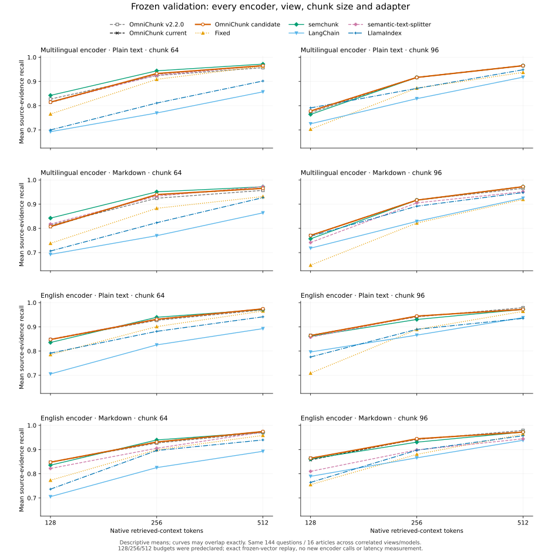

# Structural quality experiments with two frozen pretrained encoders

The candidate repairs documented-statement ownership, Markdown paragraph boundaries and oversized-prose fallback. On frozen new-English validation, **512-token recall ties the current baseline on every query in all eight settings**. The full 24-cell frontier has five small recall gains from only **two distinct questions** across correlated views/budgets; no positive recall interval excludes zero, and one gain trades precision/IoU for recall. Original synthetic-development gains cost **1.546× vectors alongside 1.015× native passage tokens at 96**. These outcomes do not establish global quality leadership or a latency advantage.

The source was frozen at `386b5ce99d4508a62725d6b36883dfa999715e8c` before the new validation split was released. The complete frozen validation and predeclared budget frontier are reported below. No validation outcome has been used to choose a rule, model, capacity or retrieval budget.

## Final behavior and compatibility

- In oversized code, an adjacent leading comment block and its fitting root statement form a structural unit; a same-line trailing inline comment belongs to that statement. Separate fitting documented units retain their own retrieval identities. Blank lines, inline-versus-leading ownership, UTF-8 whitespace, CR/LF/CRLF and JavaScript line/paragraph separators are handled explicitly. Oversized groups retain recursive fallback, and a whole code source that fits still uses its existing one-chunk fast path.
- Markdown body paragraphs separated by blank lines remain distinct. A fitting owning heading stays with following content when possible; fences and source-derived metadata remain protected. This can produce several chunks even when the complete Markdown file fits the capacity. `min_chunk_size` is a soft preference: it does not merge explicitly preserved paragraph identities back together. This is a deliberate behavior change, not a guarantee that every small Markdown file stays one chunk.
- When prose needs recursive fallback, strong semicolon clauses precede arbitrary word splitting. Heuristic sentence endpoints inside matched, unescaped square brackets are ignored; unmatched/escaped structures retain explicit fallback behavior. The guard applies to source segmentation rather than changing the public semantic sentence splitter. Complete contiguous payloads are checked with the configured counter; no query, language, dataset ID or learned score appears in the rules.

The earlier recursive-tail and orphan-heading repairs are already present in the current baseline. The final candidate adds the changes above; comparisons retain both the current baseline and released v2.2.0.

## Sources, models and declared settings

| Role | Exact revision |
| --- | --- |
| Released v2.2.0 | `fa80b981efa84d1fe8ca1cbb8556aa715c14cb0e` |
| Current default-branch baseline | `511c1cc50db8549060c9ab642ded2da96619e3db` |
| Selected development prototype | `740146d64ef8ec0078e5d32796867000b3c97a6c` |
| Final corrected/frozen candidate | `386b5ce99d4508a62725d6b36883dfa999715e8c` |

Historical original-development reports name the actual imported development commits. The earlier `ce356a2`/`a2e3bae` baseline Python source bytes match the current `511c1cc` core; the source fingerprints and freeze audit preserve that equivalence rather than relabeling historical runs as measurements from a later commit.

| Encoder alias | Pretrained model | Exact model commit | Output / model input limit |
| --- | --- | --- | --- |
| Multilingual | `sentence-transformers/paraphrase-multilingual-MiniLM-L12-v2` | `e8f8c211226b894fcb81acc59f3b34ba3efd5f42` | 384 dimensions / 128 tokens |
| English | `sentence-transformers/all-MiniLM-L6-v2` | `1110a243fdf4706b3f48f1d95db1a4f5529b4d41` | 384 dimensions / 256 tokens |

Both local snapshots were resolved to explicit commits, downloaded outside the repository and checked against pinned upstream Git/LFS metadata. Each selected snapshot has 12 files with recorded hashes, including tokenizer, weights and pooling configuration. Runtime contract checks require standard Transformer + mean Pooling, optionally Normalize, with no role prompt or custom remote code. Exact unpadded native token IDs must match overflow-checked full inputs; silent truncation is rejected. These are real pretrained-weight experiments, not random or unit-test vectors.

All primary cells use native tokenizer capacities **64 and 96**, special tokens included; whole joined retrieved contexts have **512 tokens**, including separators. The retrieved context is accounted and scored, not encoded as one model input. Top-k is 5, overlap is zero, derived context is `none`, batch size is 32, and both Torch CPU pools are 2. `--repeats 3` repeats chunking after warmup only. Index construction, encoder preparation and ranking per query are separate single measurements.

Predeclared secondary context budgets are **128 and 256**. The frontier utility reuses exact frozen vectors and ranks each candidate/query once, checks that its 512-token replay exactly reproduces the original ranks, selections, counts and scores, then applies the same complete-prefix selection at every budget. Retained timing fields belong to the original run; frontier replay is not a new per-budget latency experiment.

The six token-compatible adapters are OmniChunk, fixed source slicing, semchunk, LangChain, semantic-text-splitter and LlamaIndex. Chonkie's count-only callback cannot establish its encode/decode contract and remains explicitly excluded. Missing/failed adapters cannot become successful aggregate results. Native tokenizers differ between encoders: matching 64/96 counts within each encoder does not hold semantic payload constant across encoders, so the two models do not form a controlled model-ranking experiment.

## Data, selection and procedural separation

Original development comprises 180 synthetic English/Turkish/Japanese queries and 48 English SQuAD-subset queries. Its already observed test reports were excluded from further selection. The synthetic questions were authored alongside evidence and are not independently human-audited; code gains on these fixtures are development evidence.

A second corpus selects **32 previously unobserved-in-this-project SQuAD articles**, excluding all 16 articles from the first external corpus. A predeclared namespace-SHA256 order chooses articles, paragraphs and questions without model scores. Each article contributes 3 unmodified source paragraphs and 9 questions. Entire articles alternate into **16 development and 16 validation articles**, yielding **144 questions per split** and one source document per article per view. The 32-article design is the recorded fallback when the pinned upstream cannot provide the larger planned pool after exclusions.

Each article has a plain-text view and a Markdown view with a title prefix; paragraph bytes and questions are otherwise identical, and answer byte offsets are exactly rebased. These are **correlated views of the same 144 questions**, not 288 independent examples. Bootstrap units for this corpus are whole articles. Independent builder checks verify split separation, source hashes, answer quotations and exact view rebasing.

Validation bytes were kept encrypted until after source/model/configuration freeze, with checksums and a separate release step. This provides procedural separation within the same automated workflow; it is not independent external custody or a third-party sealed benchmark. SQuAD and Wikipedia are public and may overlap model pretraining. “New” means excluded from this project's prior observed article sets, not novel to model training.

The screening protocol was recorded before new-corpus selection. It retained every variant and all four original corpus/capacity cells, considered recall together with precision/IoU, language losses, native input tokens and vector count, and prohibited selecting from the new validation split. Long-prose sentence and citation families were explicitly added as development amendments while validation remained sealed. Intervals after this repeated screening are descriptive and do not correct development selection or multiple comparisons.

## Every recorded development variant

The table lists all recorded screen labels, including combination controls. Values are original synthetic **recall / precision**, with vector counts at 64/96. The original external development scores remain 0.979167 recall at both capacities for every label; full external metrics and all intervals are preserved in `screen-summary.json`.

| Screen | Synthetic 64 R / P | Synthetic 96 R / P | Vectors 64 / 96 | Interpretation |
| --- | --- | --- | --- | --- |
| Current baseline | 0.912709 / 0.081264 | 0.894515 / 0.084118 | 208 / 119 | Existing tail/heading repairs |
| Comment association | 0.919361 / 0.081650 | 0.900000 / 0.084591 | 217 / 127 | Repairs fitting comment/statement cuts; 96-token tradeoffs remain |
| Markdown paragraph isolation | 0.929376 / 0.082292 | 0.928987 / 0.086724 | 221 / 146 | Keeps independent authored policy paragraphs distinct |
| Association + paragraphs | 0.936028 / 0.082725 | 0.927778 / 0.086372 | 230 / 154 | Combined intermediate; four 96-token recall losses |
| Pending code leaf tail | 0.919361 / 0.081650 | 0.900000 / 0.084591 | 217 / 127 | Exact same passages and per-query quality as association; reject as unnecessary here |
| Separate documented code units | 0.919361 / 0.081615 | 0.927778 / 0.085866 | 219 / 157 | Reduces unrelated code-policy pairing; one 96-token recall loss |
| Separate code units + paragraphs | 0.936028 / 0.082706 | 0.950000 / 0.086983 | 232 / 184 | Strongest combined structural core on original development |
| Complete sentence isolation | 0.936028 / 0.082706 | 0.950000 / 0.086983 | 232 / 184 | Neutral on original fixtures; fresh-English cost/precision tradeoff below |
| Clause-first fallback | 0.936028 / 0.082706 | 0.950000 / 0.086983 | 232 / 184 | Neutral on original fixtures; addresses long-sentence structure |
| Clause + balanced-citation guard | 0.936028 / 0.082706 | 0.950000 / 0.086983 | 232 / 184 | Selected prototype, then corrected for inline ownership before final freeze |

Complete sentence isolation was rejected despite improving fresh multilingual-model English recall at 64 from 0.958333 to 0.972222. At 96, text-view vectors grew **137→265** and Markdown vectors **152→265**, while recall stayed 0.978416 and precision fell **0.010881→0.010491** / **0.010904→0.010485**. More sentences were not a consistent precision/cost improvement. The extra pending-code-tail rule was also rejected because it changed no measured input or quality result relative to comment association.

### Selected original-development outcomes

| Capacity | Metric | Current | Selected | Delta | W/T/L | 95% source-cluster delta interval |
| --- | --- | --- | --- | --- | --- | --- |
| 64 | Recall | 0.912709 | 0.936028 | +0.023319 | 9/171/0 | [0.004304, 0.048679] |
| 64 | Precision | 0.081264 | 0.082706 | +0.001442 | 75/30/75 | [-0.000244, 0.003335] |
| 64 | IoU | 0.080961 | 0.082430 | +0.001469 | 75/30/75 | [-0.000207, 0.003351] |
| 96 | Recall | 0.894515 | 0.950000 | +0.055485 | 15/164/1 | [0.009899, 0.108907] |
| 96 | Precision | 0.084118 | 0.086983 | +0.002865 | 78/14/88 | [-0.000662, 0.007088] |
| 96 | IoU | 0.084063 | 0.086983 | +0.002920 | 78/14/88 | [-0.000601, 0.007146] |

Against released v2.2.0, selected synthetic recall changes 0.901598→0.936028 at 64 (11/169/0; interval [0.007985, 0.065346]) and 0.900070→0.950000 at 96 (14/165/1; [0.007977, 0.101061]). The historical external subset stays at 0.979167 recall; its earlier tail-packing precision gain versus v2.2.0 remains, with no further gain from these new code/Markdown rules.

At 64 the selected synthetic mean exceeds the strongest named recall rival, LangChain, by **0.008946**, and the strongest precision rival, semchunk, by **0.000849**. At 96 it exceeds semchunk/semantic-text-splitter recall by **0.050000** and semchunk precision by **0.001960**. These compare actual named aggregate baselines at fixed settings, not a per-query oracle. They are selected development outcomes, not universal superiority or independent code validation.

Recall gains concentrate in code and Markdown: their slice deltas are +0.014967/+0.050000 at 64 and +0.074842/+0.066667 at 96. Table recall is unchanged, while table precision declines by 0.001207/0.001650. Japanese precision declines slightly at both capacities, and English precision declines at 96. The remaining 96-token recall loss is `en/task_lease/q05` (1→0): its full documented completion statement remains intact but loses neighboring context and falls outside the ranked prefix. All precision losses remain visible; higher aggregate precision does not mean every query improves.

| Synthetic capacity | Vectors current→selected | Native passage tokens current→selected | Mean retrieved tokens current→selected |
| --- | --- | --- | --- |
| 64 | 208→232 (+11.5%) | 8851→8899 (+0.54%) | 487.3→491.0 |
| 96 | 119→184 (+54.6%) | 8673→8803 (+1.50%) | 478.0→486.3 |

The small input-token increase does not erase the larger vector/index-count increase. Context utilization rises here, so selected synthetic precision gains are not obtained simply by returning less context. These are potential per-adapter workloads; globally deduplicated preparation timing cannot be attributed to a single adapter.

## New English article development at 512 tokens

The original paragraph rule is exactly neutral on the new long-article views. All 48 development paragraphs exceed 64 native multilingual-model tokens, and only two fit 96; existing boundaries already keep the latter separate. Lower-level causal analysis found two prefix-budget misses with identical gold embeddings, one answer requiring preceding context, a 97-token sentence leaving a tiny answer tail at capacity 96, and a heuristic endpoint inside a balanced citation. The clause/citation rules address general source structure without special-casing those questions.

| Encoder / view / capacity | Current recall | Selected recall | Selected precision / IoU | Recall W/T/L and 95% delta CI | Vectors current→selected |
| --- | --- | --- | --- | --- | --- |
| Multilingual / text / 64 | 0.958333 | 0.957583 | 0.010303 / 0.010302 | 0/143/1; [-0.002252, 0] | 205→206 |
| Multilingual / Markdown / 64 | 0.958333 | 0.957583 | 0.010295 / 0.010294 | 0/143/1; [-0.002252, 0] | 221→222 |
| Multilingual / text / 96 | 0.978416 | 0.986111 | 0.010973 / 0.010973 | 2/142/0; [0, 0.022335] | 137→137 |
| Multilingual / Markdown / 96 | 0.978416 | 0.986111 | 0.010977 / 0.010977 | 2/142/0; [0, 0.022335] | 152→152 |
| English / text / 64 | 0.986111 | 0.986111 | 0.009559 / 0.009559 | 0/144/0; [0, 0] | 185→185 |
| English / Markdown / 64 | 0.986111 | 0.986111 | 0.009585 / 0.009585 | 0/144/0; [0, 0] | 200→200 |
| English / text / 96 | 0.993056 | 0.993056 | 0.009850 / 0.009850 | 0/144/0; [0, 0] | 122→122 |
| English / Markdown / 96 | 0.993056 | 0.993056 | 0.009849 / 0.009849 | 0/144/0; [0, 0] | 136→136 |

The multilingual 64-token loss is partial, yielding -0.000751 mean recall in each correlated view. At 96 recall gains +0.007695 in each view. Text-view precision rises +0.000093 (22/118/4; descriptive interval [0.000010, 0.000200]); Markdown precision rises +0.000073 (21/118/5; interval [-0.000013, 0.000182]). With the English encoder recall ties throughout: text-view 64 precision declines **-0.000037** (13/110/21; interval [-0.000078, -0.000002]), Markdown 64 rises +0.000010 with an interval crossing zero, and both 96-token source-evidence metrics tie. The second model therefore does not confirm a blanket quality improvement.

semchunk remains stronger in new multilingual-model English recall at 64 (0.976389); selected 96 recall ties its 0.986111. Text-view selected precision at 96 remains below semchunk's 0.010998, while Markdown selected precision exceeds its 0.010942 slightly. The English-model text-view selected recall ties semchunk/ST at both capacities; Markdown selected recall trails fixed at 64 and ST at 96 by 1/144. Named-rival tradeoffs, all slice metrics, actual context usage and input costs are retained in `new-development-summary.json`.

New article native passage-token counts change by only +2 at multilingual 64 and remain unchanged at 96 and with the English model. Most contextual representation differences therefore come from boundaries rather than added encoded volume. These English prose articles do not exercise the code-group path. The code changes have stronger original synthetic development results and correctness regressions, but **no independent new code-retrieval validation** is implied.

## Correctness review, superseded freeze and final source identity

The first candidate freeze was superseded **before validation release** after a code review found that a trailing inline comment could be assigned to the following documented statement. The final fix retains the inline comment with its owning statement and covers Unicode whitespace/line-separator edges. The correction was driven by source ownership, not validation scores; the original freeze and superseding record remain preserved.

`input-equivalence-v2.json` regenerates every ordered development Passage object with the final source and each native tokenizer: **6 anchor reports, 12 capacity rows**. IDs, source offsets, exact text, UTF-8 totals, maximum native sizes and total/unique token workloads match the selected `740146d` reports exactly. No embedding inference or quality rescoring was used. The record is bound to final commit `386b5ce`; its Python source fingerprint is `215b2181cfc7cec884d828988bffea0d81103600083352d8471b0627f45ddf62`. Historical development reports retain their original measured runtime revision rather than being rewritten to the final one.

The replacement freeze is `2026-10-26T18:54:56.487550+00:00`. The source, model/file hashes, installed environment, builder, all development anchors and code-review state were checked before release. Code review completed without findings on exactly `386b5ce`; this does not imply a completed security review. Validation measures the final frozen runtime directly.

## Primary frozen validation at 512 tokens

The one declared 12-run validation matrix is complete. Against the current `511c1cc` baseline, the candidate has **identical source-evidence recall on every query at all eight encoder/view/capacity settings**: 0 wins, 144 ties, 0 losses and a [0, 0] paired delta interval in each cell. The strong original synthetic-development recall gains therefore do **not** demonstrate an independent 512-token recall gain on these new English articles. These articles do not exercise the AST code path; independent new code-retrieval validation is still absent.

Tables show complete-context **recall / precision / IoU**. Release is v2.2.0; current is `511c1cc`; candidate is the frozen `386b5ce`. The five rivals were measured in current-runtime cells. All values are reported at fixed settings, without selecting favorable models, views or capacities.

### Multilingual encoder

| Runtime / adapter | Text64 R / P / IoU | Text96 R / P / IoU | Markdown64 R / P / IoU | Markdown96 R / P / IoU |
| --- | --- | --- | --- | --- |
| release | 0.957031 / 0.007700 / 0.007700 | 0.965278 / 0.008231 / 0.008231 | 0.957031 / 0.007716 / 0.007716 | 0.965278 / 0.008253 / 0.008253 |
| current | 0.965278 / 0.007862 / 0.007862 | 0.965278 / 0.008218 / 0.008218 | 0.965278 / 0.007800 / 0.007800 | 0.972222 / 0.008273 / 0.008273 |
| candidate | 0.965278 / 0.007862 / 0.007862 | 0.965278 / 0.008218 / 0.008218 | 0.965278 / 0.007804 / 0.007804 | 0.972222 / 0.008273 / 0.008273 |
| fixed | 0.963085 / 0.007956 / 0.007956 | 0.937500 / 0.008043 / 0.008043 | 0.931250 / 0.007733 / 0.007732 | 0.919560 / 0.007928 / 0.007928 |
| semchunk | 0.971788 / 0.007879 / 0.007879 | 0.965278 / 0.008283 / 0.008283 | 0.971788 / 0.007870 / 0.007870 | 0.972222 / 0.008296 / 0.008296 |
| langchain | 0.857219 / 0.006826 / 0.006824 | 0.917800 / 0.007351 / 0.007350 | 0.864164 / 0.006847 / 0.006845 | 0.924744 / 0.007360 / 0.007359 |
| semantic-text-splitter | 0.965278 / 0.007864 / 0.007864 | 0.965278 / 0.008219 / 0.008219 | 0.972222 / 0.007853 / 0.007853 | 0.951389 / 0.008091 / 0.008091 |
| llamaindex | 0.901933 / 0.007297 / 0.007296 | 0.948413 / 0.007917 / 0.007917 | 0.926996 / 0.007469 / 0.007467 | 0.947774 / 0.007801 / 0.007800 |

### English encoder

| Runtime / adapter | Text64 R / P / IoU | Text96 R / P / IoU | Markdown64 R / P / IoU | Markdown96 R / P / IoU |
| --- | --- | --- | --- | --- |
| release | 0.970119 / 0.007111 / 0.007111 | 0.979167 / 0.007410 / 0.007410 | 0.970119 / 0.007109 / 0.007109 | 0.979167 / 0.007422 / 0.007422 |
| current | 0.974392 / 0.007172 / 0.007172 | 0.972222 / 0.007320 / 0.007320 | 0.974392 / 0.007178 / 0.007178 | 0.972222 / 0.007323 / 0.007323 |
| candidate | 0.974392 / 0.007172 / 0.007172 | 0.972222 / 0.007320 / 0.007320 | 0.974392 / 0.007178 / 0.007178 | 0.972222 / 0.007333 / 0.007333 |
| fixed | 0.965313 / 0.007096 / 0.007096 | 0.963790 / 0.007389 / 0.007389 | 0.958333 / 0.007153 / 0.007153 | 0.963816 / 0.007426 / 0.007426 |
| semchunk | 0.971788 / 0.007115 / 0.007115 | 0.972222 / 0.007402 / 0.007402 | 0.971788 / 0.007130 / 0.007130 | 0.972222 / 0.007404 / 0.007404 |
| langchain | 0.892827 / 0.006338 / 0.006337 | 0.938237 / 0.006597 / 0.006597 | 0.892827 / 0.006341 / 0.006340 | 0.938237 / 0.006597 / 0.006596 |
| semantic-text-splitter | 0.974392 / 0.007173 / 0.007173 | 0.972222 / 0.007340 / 0.007340 | 0.972222 / 0.007161 / 0.007161 | 0.944444 / 0.007103 / 0.007103 |
| llamaindex | 0.941468 / 0.006813 / 0.006813 | 0.934960 / 0.006607 / 0.006606 | 0.939709 / 0.006642 / 0.006641 | 0.956996 / 0.006841 / 0.006840 |

Candidate-versus-current precision and IoU are exactly tied in five settings. Only the following three cells change; precision and IoU have the same deltas and W/T/L in each. The small improvements are mixed with losses and are not a general quality claim.

| Encoder / view / tokens | Precision and IoU delta | W/T/L | 95% delta interval |
| --- | --- | --- | --- |
| multilingual / article-text / 64 | -0.000000175 | 0/143/1 | [-0.000000524, 0.000000000] |
| multilingual / article-markdown / 64 | +0.000003617 | 1/142/1 | [0.000000000, 0.000010852] |
| english / article-markdown / 96 | +0.000009965 | 7/131/6 | [-0.000002426, 0.000026259] |

| Encoder / view / tokens | Recall delta vs v2.2.0; W/T/L; 95% CI |
| --- | --- |
| multilingual / article-text / 64 | +0.008247; 2/142/0; [0.000000, 0.023470] |
| multilingual / article-text / 96 | +0.000000; 0/144/0; [0.000000, 0.000000] |
| multilingual / article-markdown / 64 | +0.008247; 2/142/0; [0.000000, 0.023470] |
| multilingual / article-markdown / 96 | +0.006944; 1/143/0; [0.000000, 0.020833] |
| english / article-text / 64 | +0.004274; 1/143/0; [0.000000, 0.012821] |
| english / article-text / 96 | -0.006944; 0/143/1; [-0.020833, 0.000000] |
| english / article-markdown / 64 | +0.004274; 1/143/0; [0.000000, 0.012821] |
| english / article-markdown / 96 | -0.006944; 0/143/1; [-0.020833, 0.000000] |

Differences versus v2.2.0 include the current baseline's earlier repairs; they cannot be attributed entirely to this candidate. The English encoder at 96 loses one recall query relative to v2.2.0 in both correlated views, while candidate/current tie. All released/current/candidate and rival paired metrics remain in the raw comparisons.

| Encoder / view / tokens | Vectors current→candidate | Native passage tokens current→candidate | Mean context tokens current→candidate |
| --- | --- | --- | --- |
| multilingual / article-text / 64 | 210→210 | 9511→9511 | 485.3→485.4 |
| multilingual / article-text / 96 | 136→136 | 9363→9363 | 475.5→475.5 |
| multilingual / article-markdown / 64 | 225→225 | 9598→9598 | 487.7→487.5 |
| multilingual / article-markdown / 96 | 149→149 | 9446→9446 | 472.9→472.9 |
| english / article-text / 64 | 181→181 | 8282→8282 | 486.8→486.8 |
| english / article-text / 96 | 122→122 | 8164→8164 | 477.4→477.4 |
| english / article-markdown / 64 | 195→195 | 8362→8362 | 486.8→486.8 |
| english / article-markdown / 96 | 134→135 | 8240→8242 | 476.2→476.5 |

Seven primary cells retain the same vector and native-token counts as current; English Markdown96 adds one vector and two native tokens. Context usage changes only slightly. At 64 the multilingual candidate still trails semchunk recall in text, and semchunk/ST in Markdown. At 96 its multilingual recall ties semchunk while its precision trails semchunk. English64 has competitive recall with mixed precision; English96 ties semchunk recall but trails its precision, and some fixed baselines retrieve fewer relevant bytes at higher precision. These comparisons do not establish universal or Pareto superiority.

All eight cells reuse the same 144 questions and 16 articles per view/encoder. Views/models are not pooled as independent samples. **Sampling stops after this frozen matrix:** no source, model or configuration change, new model run, replacement sample or favorable-cell selection is made from validation. The remaining work is reporting the already declared frozen-vector frontier and uncertainty.

## Complete predeclared context-budget frontier

All 12 frozen-vector replays and 84 paired comparisons are complete. Every 512-token anchor reproduces its entire original report exactly after removing only added replay provenance. There were no new encoder calls or replacement samples. Across all 24 fixed settings, candidate/current recall has five positive mean cells and nineteen exact ties, with no recall-loss query-setting instance. These involve only **two distinct questions**: four gains repeat one multilingual-model 64-token case at budgets 128/256 in both correlated views; the other is English Markdown96 at 128. Every positive recall delta interval touches zero.

The English Markdown96/128 gain trades precision/IoU for recall. Across all settings, precision/IoU means rise in seven cells, decline in two and tie in fifteen. The multilingual text64/512 loss is tiny but retained. No favorable budget is selected for the headline.

Each paired field below is **delta; W/T/L; 95% article-component interval**. All 144 query pairs are retained per cell, with no pooling across models/views/budgets.

| Encoder / view / chunk tokens | Context tokens | Recall current→candidate | Δ recall; W/T/L; CI | Δ precision; W/T/L; CI | Δ IoU; W/T/L; CI |
| --- | --- | --- | --- | --- | --- |
| multilingual / text / 64 | 128 | 0.813368→0.814670 | +0.001302; 1/143/0; [0, 0.003906] | +0.000248; 2/141/1; [0, 0.000744] | +0.000254; 2/141/1; [0, 0.000762] |
| multilingual / text / 64 | 256 | 0.931424→0.932726 | +0.001302; 1/143/0; [0, 0.003906] | +0.000055; 2/142/0; [0, 0.000166] | +0.000056; 2/142/0; [0, 0.000169] |
| multilingual / text / 64 | 512 | 0.965278→0.965278 | 0; 0/144/0; [0, 0] | -0.000000175; 0/143/1; [-0.000000524, 0] | -0.000000175; 0/143/1; [-0.000000524, 0] |
| multilingual / text / 96 | 128 | 0.777778→0.777778 | 0; 0/144/0; [0, 0] | 0; 0/144/0; [0, 0] | 0; 0/144/0; [0, 0] |
| multilingual / text / 96 | 256 | 0.916667→0.916667 | 0; 0/144/0; [0, 0] | 0; 0/144/0; [0, 0] | 0; 0/144/0; [0, 0] |
| multilingual / text / 96 | 512 | 0.965278→0.965278 | 0; 0/144/0; [0, 0] | 0; 0/144/0; [0, 0] | 0; 0/144/0; [0, 0] |
| multilingual / Markdown / 64 | 128 | 0.806424→0.807726 | +0.001302; 1/143/0; [0, 0.003906] | +0.000394; 4/140/0; [0, 0.001183] | +0.000399; 4/140/0; [0, 0.001196] |
| multilingual / Markdown / 64 | 256 | 0.938368→0.939670 | +0.001302; 1/143/0; [0, 0.003906] | +0.000028; 3/141/0; [0, 0.000084] | +0.000029; 3/141/0; [0, 0.000087] |
| multilingual / Markdown / 64 | 512 | 0.965278→0.965278 | 0; 0/144/0; [0, 0] | +0.000003617; 1/142/1; [0, 0.000011] | +0.000003617; 1/142/1; [0, 0.000011] |
| multilingual / Markdown / 96 | 128 | 0.770833→0.770833 | 0; 0/144/0; [0, 0] | 0; 0/144/0; [0, 0] | 0; 0/144/0; [0, 0] |
| multilingual / Markdown / 96 | 256 | 0.916667→0.916667 | 0; 0/144/0; [0, 0] | 0; 0/144/0; [0, 0] | 0; 0/144/0; [0, 0] |
| multilingual / Markdown / 96 | 512 | 0.972222→0.972222 | 0; 0/144/0; [0, 0] | 0; 0/144/0; [0, 0] | 0; 0/144/0; [0, 0] |
| english / text / 64 | 128 | 0.847780→0.847780 | 0; 0/144/0; [0, 0] | 0; 0/144/0; [0, 0] | 0; 0/144/0; [0, 0] |
| english / text / 64 | 256 | 0.931114→0.931114 | 0; 0/144/0; [0, 0] | 0; 0/144/0; [0, 0] | 0; 0/144/0; [0, 0] |
| english / text / 64 | 512 | 0.974392→0.974392 | 0; 0/144/0; [0, 0] | 0; 0/144/0; [0, 0] | 0; 0/144/0; [0, 0] |
| english / text / 96 | 128 | 0.864198→0.864198 | 0; 0/144/0; [0, 0] | 0; 0/144/0; [0, 0] | 0; 0/144/0; [0, 0] |
| english / text / 96 | 256 | 0.944444→0.944444 | 0; 0/144/0; [0, 0] | 0; 0/144/0; [0, 0] | 0; 0/144/0; [0, 0] |
| english / text / 96 | 512 | 0.972222→0.972222 | 0; 0/144/0; [0, 0] | 0; 0/144/0; [0, 0] | 0; 0/144/0; [0, 0] |
| english / Markdown / 64 | 128 | 0.847780→0.847780 | 0; 0/144/0; [0, 0] | 0; 0/144/0; [0, 0] | 0; 0/144/0; [0, 0] |
| english / Markdown / 64 | 256 | 0.931114→0.931114 | 0; 0/144/0; [0, 0] | 0; 0/144/0; [0, 0] | 0; 0/144/0; [0, 0] |
| english / Markdown / 64 | 512 | 0.974392→0.974392 | 0; 0/144/0; [0, 0] | 0; 0/144/0; [0, 0] | 0; 0/144/0; [0, 0] |
| english / Markdown / 96 | 128 | 0.857253→0.864198 | +0.006944; 1/143/0; [0, 0.020833] | -0.000070; 3/137/4; [-0.000210, 0] | -0.000070; 3/137/4; [-0.000210, 0] |
| english / Markdown / 96 | 256 | 0.944444→0.944444 | 0; 0/144/0; [0, 0] | +0.000030; 4/136/4; [0, 0.000089] | +0.000030; 4/136/4; [0, 0.000089] |
| english / Markdown / 96 | 512 | 0.972222→0.972222 | 0; 0/144/0; [0, 0] | +0.000009965; 7/131/6; [-0.000002426, 0.000026] | +0.000009965; 7/131/6; [-0.000002426, 0.000026] |

The eight panels show all six adapter choices plus released/current OmniChunk at 128/256/512 native context tokens; curves can overlap exactly. These are descriptive source-evidence means, not latency curves or independently replicated observations. The complete numeric curves for recall, precision and IoU are in `validation-curves.csv`; `validation-summary.json/.md` retains all named-rival paired intervals and cost dimensions.

Named-rival ordering varies across encoder, view, chunk size and budget. The primary 512-token ties must not be presented as an independent recall improvement; smaller-budget gains are narrow and include a precision tradeoff. No universal ranking, Pareto superiority or production latency benefit follows. **Sampling has stopped:** this report closes the frozen experiment without changing or rerunning the candidate from validation outcomes.

## Timing, memory and cost interpretation

The recorded environment is CPython 3.12.14 on Linux x86_64 with an AMD EPYC virtual CPU. Torch 2.14.1+cpu, sentence-transformers 6.2.0, transformers 5.20.2 and the pinned comparator requirements are recorded alongside both model snapshots. Both Torch pools are explicitly 2; model limits are checked against full native input IDs. The final environment record hashes installed bytes for 172 distributions, not upstream wheel archives; the installed-file manifest SHA-256 is `8c17eae74f4a0ab4a2f45cdbc55e9e4d5650db79c609dba4b37d3fb7bf43647f`.

Encoder preparation deduplicates passage payloads within each role across every adapter/capacity in that pass. Its token/batch statistics, model-load/hash/validation/encoding times and process RSS are global preparation measurements. They are not a single chunker's embedding bill, independent online query latency, or a controlled comparison between an OmniChunk-only screen and a six-adapter pass. Per-adapter total/unique passage tokens and vector counts are the relevant workload comparisons.

The actual 12 original producer rows, including unique passage/query counts, native token totals, batches, encode/load seconds and process RSS, are tabulated in [validation-summary.md](validation-summary.md#actual-original-producer-statistics). Current rows encode six adapters, while release/candidate rows encode OmniChunk only; their global preparation times are not isolated chunker speed comparisons.

Chunking has warmup plus three timed samples and a separate allocation-memory pass. Index construction is timed once and ranking once per query. Frozen lookup/cosine ranking excludes encoding, budget selection, evidence scoring, network/vector-database latency and answer generation. RSS is the process-lifetime high-water mark, not isolated per-adapter encoder memory; Python allocation peaks omit native allocators. Original and replayed frontier timings are not separate end-to-end measurements. No chunking-speed or production-latency superiority claim follows from this report.

## Metrics, uncertainty and reproducibility

The primary scores union exact canonical UTF-8 source-byte intervals: recall measures recovered gold bytes, precision measures the share of retrieved bytes that are gold, and IoU measures their intersection over union. Whole ranked-prefix selection counts the joined context with separators and stops at the first non-fitting passage; it does not skip to a smaller lower-ranked item. Top-k 5 controls separate ranking/evidence@5 metrics, not a five-passage cap on the 512-token prefix. Chunk-level relevance changes with boundaries, so source-evidence metrics remain the common basis.

Paired intervals use 2,000 deterministic percentile bootstrap samples, seed 0, clustering questions connected by gold source IDs. The new corpus has one source per article and therefore 16 article components per split/view. Original external paragraphs can share an article and retain correlation beyond their source cluster. Intervals do not correct repeated development screening, model/view selection or multiple metrics; tied or positive means alone do not establish leadership.

The final raw-data destination is `reports/structural-quality-v2` within the repository's retrieval evidence area. Preserve the original screen reports, both development summaries, protocol/amendments, model/environment manifests, both freeze records and superseding explanation, exact-input audit, full validation reports, paired comparisons and the entire declared frontier. Frozen vector artifacts remain outside the repository; their hashes are retained in the raw reports, and the pinned snapshots/producer can regenerate them. Model weights also stay outside the repository. Run the standalone screen/frontier/matrix helpers with the recorded local snapshots and package versions; the model producer itself does not download weights.

Original synthetic material and benchmark software are MIT licensed. SQuAD-derived source passages, including those reproduced in raw retrieval reports, retain CC-BY-SA-4.0 attribution to Wikipedia contributors and the SQuAD 1.1 authors (Rajpurkar, Zhang, Lopyrev and Liang); manifests record article links and the pinned upstream checksum. The English second encoder is evidence about English, not multilingual coverage. Public pretraining overlap, short-answer labels that are not independently audited complete supporting evidence, synthetic Markdown rendering, a small article sample and absence of downstream answer-generation or production demand limit generalization.

M1 remains open for independent supporting-evidence suitability review and production design-partner evidence. Structural correctness, reproducible evaluation and scoped measured improvements do not by themselves justify a universal ranking, release or milestone-completion claim.

Stored evidence uses deterministic gzip for larger original JSON/log files. `storage-map.json` maps the original workspace-relative names to stored files and records the original byte hashes; decompress files marked gzip to check their freeze hashes. `evidence-sha256.json` covers exact stored bytes except itself. The experimental source bundle retains the original trial commits; its prerequisite is the original PR #35 head `ce356a251b156ed3a5b8607793224c3a4dc47ee1`, available from that pull-request ref. New corpus views are published separately under `../../corpus_squad_v2/`.
